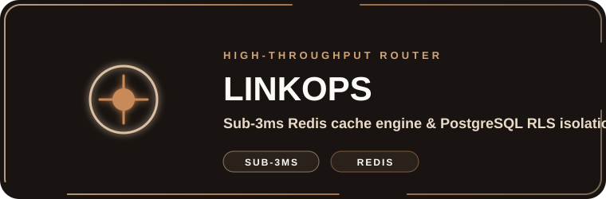
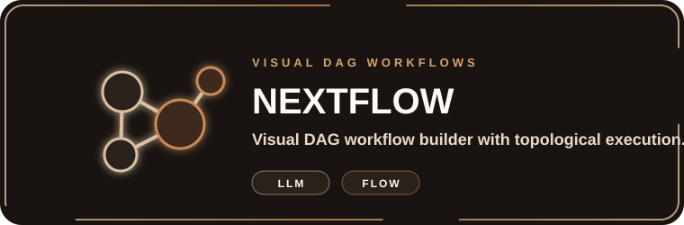
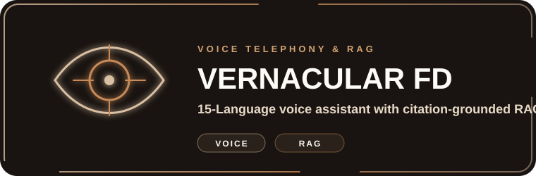
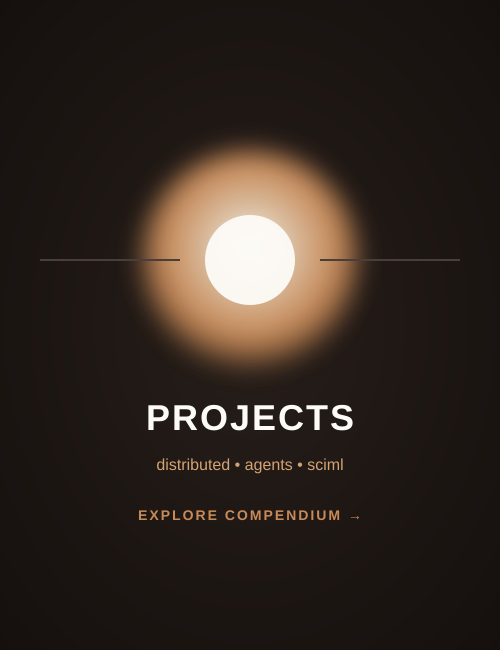
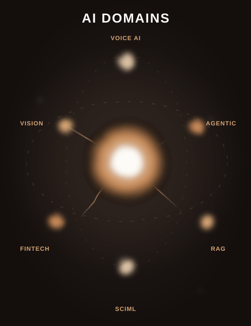
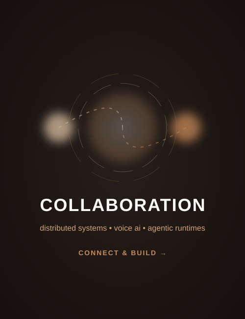

<p align="center">
  
</p>

<h3 align="center">
  <samp>
    &gt; Software Engineer | Backend Architect, Voice AI &amp; ML Systems
  </samp>
</h3>

<p align="center">
  
</p>

<!-- Recruiter Fast-Action Bar (From Screenshot) -->
<p align="center">
  <a href="https://himanshu.social" target="_blank">
    
  </a>
  <a href="https://www.linkedin.com/in/himanshu-sharma-ab7101313/" target="_blank">
    
  </a>
  <a href="mailto:himanshusharmamig196@gmail.com">
    
  </a>
  <a href="https://leetcode.com/u/himanshusharma_/" target="_blank">
    
  </a>
  <a href="https://github.com/HIMpcgithub3000">
    
  </a>
</p>

<p align="center">
  
  
  
</p>

<p align="center">
  <a href="#-recruiter-snapshot"><b>[ 👤 Recruiter Snapshot ]</b></a> •
  <a href="#-production-engineering-experience"><b>[ 💼 Production Experience ]</b></a> •
  <a href="#-featured-engineering-projects"><b>[ 🚀 Featured Projects ]</b></a> •
  <a href="#-technologies-projects-and-domains"><b>[ 🛠 Tech Matrix ]</b></a> •
  <a href="#-honors--hackathons"><b>[ 🏆 Honors ]</b></a> •
  <a href="#-vital-statistics"><b>[ 📊 Vital Stats ]</b></a> •
  <a href="#-contact"><b>[ 📫 Connect ]</b></a>
</p>

[](https://github.com/HIMpcgithub3000)

<!-- System Access Portal & Labs (Matching Warm Beige / Mocha Palette) -->
<p align="center">
  
</p>

<p align="center">
  <a href="https://github.com/HIMpcgithub3000">
    
  </a>
</p>

<p align="center">
  <a href="https://github.com/HIMpcgithub3000/linklops">
    
  </a>
  <a href="https://github.com/HIMpcgithub3000/nextflow">
    
  </a>
</p>

<p align="center">
  <a href="https://github.com/HIMpcgithub3000/Vernacular-FD-Advisor">
    
  </a>
  <a href="https://github.com/HIMpcgithub3000/medimind">
    
  </a>
</p>

[](https://github.com/HIMpcgithub3000)

<!-- System Core Panel -->
<p align="center">
  
</p>

[](https://github.com/HIMpcgithub3000)

<a id="-recruiter-snapshot"></a>
## 👤 Recruiter Snapshot

> High-impact Software Engineer and Applied AI builder with production experience spanning **distributed backend systems**, **real-time voice/speech telephony pipelines**, and **autonomous agent orchestration**. Architected sub-3ms high-throughput cache routers, engineered acoustic pipelines converting 8kHz to 16kHz across 12 concurrent Twilio channels with dual-layer prompt injection defense, and delivered multi-lender core fintech lending APIs across 5 NBFCs and 2 commercial banks.

| Category | Fast Facts &amp; Credentials |
| :--- | :--- |
| **🎓 Education** | **BML Munjal University**, Gurugram — B.Tech Computer Science &amp; Engineering (*Aug 2023 – Expected May 2027*)<br>↳ *Specialization:* **Data Science &amp; AI in Financial Markets** |
| **💼 Industry Track** | **Blostem** — *Software Development Engineer Intern* (Core production engineering across Nexus, VoiceBrew &amp; Lending APIs) |
| **⚡ Backend Core** | Node.js, Express.js, FastAPI, PostgreSQL (RLS, `pg_trgm`), Redis (single-flight distributed locks, OTP stores), Kafka, Docker |
| **🎙️ Voice &amp; Speech AI** | Real-time audio streaming (8kHz to 16kHz resampling), Twilio SIP trunking, Sarvam AI, ElevenLabs, Deepgram Nova-3, Pipecat |
| **🧠 Agentic &amp; SciML** | Model Context Protocol (MCP over SSE/HTTP), LangGraph, CrewAI, local Gemma 3, PyTorch, SINDy sparse ODE discovery |
| **📍 Availability &amp; Relocation** | **Immediate / 2026-2027 Graduate** • Open to **Bengaluru, Mumbai, Delhi NCR, or Remote** |

<a id="-production-engineering-experience"></a>
## 💼 Production Engineering Experience

### **Blostem** — *Software Development Engineer Intern*
*June 2026 – Present | Gurugram / Noida, India*

```
├── Nexus ────────── Autonomous Agent Orchestration Runtime & IT Incident Triage (1,419-line engine)
├── VoiceBrew ────── Sub-200ms Telephony Speech Streaming & 12-Channel Trunking Engine
└── Lending Core ─── Multi-Lender Lending API Engine across 5 NBFCs & 2 Commercial Banks
```

<details open>
<summary><b>1. Nexus — Autonomous Agent Orchestration &amp; IT Automation (<a href="https://nexus.blostem.com" target="_blank">nexus.blostem.com</a>)</b></summary>
<br>

- **Child-Process Dispatch Engine:** Engineered a 1,419-line dispatch runtime spawning Claude Code and Codex CLI as streaming child processes with real-time JSON event feeds; implemented headless action auto-approvals and scoped shell sandboxing to prevent privilege escalation.
- **MCP Client Architecture:** Integrated external agent tools via **Model Context Protocol (MCP)** over SSE and streamable HTTP transports, dynamically registering and validating function catalogues across 25+ platform routes with strict schema verification.
- **Automated Incident Triage Pipeline:** Formulated an automated production incident triage pipeline deduplicating alerts by SHA-256 fingerprint over 5 signals, integrating SigNoz telemetry and source tracing to **slash error investigation from 3 hours to ~10 minutes**.
- **Production Hardening:** Resolved critical production defects including a cascade-delete vulnerability affecting 657 database rows and closed security vulnerabilities across 9 unreachable platform modules; backed by **700+ Vitest and Playwright regression suites**.

</details>

<details>
<summary><b>2. VoiceBrew — Telephony Architecture &amp; Speech AI Pipeline (<a href="https://voicebrew.ai" target="_blank">voicebrew.ai</a>)</b></summary>
<br>

- **Sub-200ms Telephony Stream:** Engineered an acoustic telephony speech streaming pipeline converting 8 kHz to 16 kHz signals with user-turn coalescing, stripping internal reasoning tokens to preserve natural spoken dialogue cadence within 200ms.
- **Telephony &amp; Multi-Provider Integration:** Voiced synthesized dialogue via Sarvam AI and ElevenLabs over Twilio trunking with 12 concurrent channels, executing heuristic noise filtering to maintain conversational fluidity.
- **Dual-Layer Responsible AI Guardrails:** Enforced a two-layer safety guardrail combining sub-10ms deterministic regex checks with runtime safety audits, **neutralizing 100% of prompt injections and off-policy jailbreaks across 5,000+ benchmarked adversarial evaluations on live calls**.
- **Foundation Model Orchestration:** Orchestrated Vertex AI Gemini 2.5 Flash foundations with external MCP agent tools over SSE, executing strict JSON schema validation spanning 62+ financial intents.
- **Context &amp; State Cache:** Structured warm-cache-first state stores in Redis with 300-second TTL cooldowns and intent stacks, preventing redundant vector retrievals to **stabilize context latency under 1,000+ concurrent sessions**.

</details>

<details>
<summary><b>3. Personal Loan Marketplace — Core Lending API (<a href="https://blostem.com" target="_blank">blostem.com</a>)</b></summary>
<br>

- **Weighted Decision Underwriting Engine:** Architected a weighted decision system matching applicant CIBIL scores against lender underwriting rules across 5 NBFCs and 2 commercial banks, routing applications to maximize approval rates.
- **Relational Schemas &amp; Multi-Tenant Isolation:** Designed normalized relational database schemas spanning 3 licensed lenders (Unity SFB, InCred, CreditSea), enforcing strict foreign-key integrity, PostgreSQL Row-Level Security, and data protection controls.
- **High-Throughput Concurrency:** Engineered 12 REST endpoints utilizing asynchronous `Promise.all` concurrency to fan out credit verification calls in parallel, **trimming aggregated response latency by 45%**.
- **Cryptographic Security Middleware:** Constructed custom Express middleware chains combining cryptographic SHA-256 payload hashing with timestamp and nonce verification to prevent replay attacks covering 13 routes.
- **Hardened Authentication:** Hardened user authentication via OAuth 2.0 and short-lived JWT tokens, storing OTP session secrets in Redis with TTL expiration and 5-attempt lockout thresholds.

</details>

<a id="-featured-engineering-projects"></a>
## 🚀 Featured Engineering Projects

### ⚡ Category 1: High-Performance Distributed Systems &amp; Backend Engineering

#### 🔗 **LinkOps** — High-Performance Multi-Tenant Redirection Router &amp; Analytics Platform
<p>
  
  
  
  <a href="https://github.com/HIMpcgithub3000/linklops" target="_blank">
    
  </a>
  <a href="https://linkops.dev" target="_blank">
    
  </a>
</p>

*A production-grade multi-tenant URL shortening, high-throughput routing, and clickstream analytics engine built for enterprise scale.*

- **Sub-3ms Latency Router:** Delivered a high-throughput redirect engine utilizing single-flight Redis locks and in-memory multi-tiered caching, completely eliminating thundering-herd spikes over 100,000+ requests.
- **Multi-Tenant Isolation via RLS:** Established strict PostgreSQL Row-Level Security (RLS) policies with tenant session contexts, isolating 100% of cross-tenant records under scheduled database integrity audits.
- **Async 1-Hour Aggregation Workers:** Aggregated raw click events into 1-hour rollup analytical buckets via asynchronous background queues and idempotent SQL updates with unique idempotency keys.

#### 🔀 **NextFlow** — Visual DAG Workflow Orchestration &amp; Multimodal Engine
<p>
  
  
  <a href="https://github.com/HIMpcgithub3000/nextflow" target="_blank">
    
  </a>
</p>

*Interactive visual DAG builder and deterministic workflow engine that compiles visual nodes into topological execution plans for multimodal LLM tasks.*

### 🧠 Category 2: Autonomous Agents, Voice Intelligence &amp; Telephony

#### 🤖 **AI PR Assistant** — Multi-Agent Autonomous Code Review Platform
<p>
  
  
  
  <a href="https://github.com/HIMpcgithub3000/Ai_pr_assistant" target="_blank">
    
  </a>
</p>

*Autonomous multi-agent code inspection system delivering zero-trust, AST-verified PR feedback with sandboxed regression test execution in isolated Docker containers (`POOL_MGR`).*

#### 🗣️ **Vernacular FD Advisor** — Multilingual Citation-Grounded Voice Assistant
<p>
  
  
  <a href="https://github.com/HIMpcgithub3000/Vernacular-FD-Advisor" target="_blank">
    
  </a>
</p>

*Multilingual conversational wealth assistant supporting 15 Indian languages, using speech STT/TTS and FAISS RAG to deliver accurate, citation-backed fixed-deposit advisory.*

### 🔬 Category 3: Scientific ML, Quantitative Finance &amp; Clinical AI

#### 📈 **Scientific Machine Learning &amp; Epidemiological Forecasting**
<p>
  
  
  
  <a href="https://github.com/HIMpcgithub3000/influenza-forecasting-hhs-regions" target="_blank">
    
  </a>
</p>

*Pioneering hybrid SciML pipeline combining sparse differential equation discovery (SINDy via STLSQ) with non-parametric residual estimators for multi-region epidemiological modeling.*

#### 📊 **Quantitative Stock Forecasting** — Econometric &amp; GBDT Ensembles
<p>
  
  
  
  <a href="https://github.com/HIMpcgithub3000/Quantitative_analysis_of_stocks" target="_blank">
    
  </a>
</p>

*Econometric modeling benchmarking ARIMA against Gradient Boosted Decision Trees (GBR) across 11,325 daily OHLCV bars across mega-cap equities achieving 2.12% out-of-sample MAPE without lookahead bias.*

#### 🩺 **MediMind** — Clinical Information Retrieval &amp; Hybrid RAG Console
<p>
  
  
  <a href="https://github.com/HIMpcgithub3000/medimind" target="_blank">
    
  </a>
</p>

*Clinical QA engine combining FAISS and ChromaDB hybrid search, cross-encoder reranking, and local Gemma 3 with real-time SSE streaming responses.*

[](https://github.com/HIMpcgithub3000)

<a id="-technologies-projects-and-domains"></a>
# 🛠 Technologies, Projects, and Domains

<table border="0" cellspacing="10" cellpadding="0">
<tr>

<!-- LEFT: TOOLS -->
<td width="420" valign="top" align="center">

<h3>🛠 Technologies</h3>
<br>

<table align="center" cellspacing="0" cellpadding="6">
  <tr>
    <td align="center"></td>
    <td align="center"></td>
    <td align="center"></td>
    <td align="center"></td>
    <td align="center"></td>
  </tr>
  <tr>
    <td align="center"></td>
    <td align="center"></td>
    <td align="center"></td>
    <td align="center"></td>
    <td align="center"></td>
  </tr>
  <tr>
    <td align="center"></td>
    <td align="center"></td>
    <td align="center"></td>
    <td align="center"></td>
    <td align="center"></td>
  </tr>
  <tr>
    <td align="center"></td>
    <td align="center"></td>
    <td align="center"></td>
    <td align="center"></td>
    <td align="center"></td>
  </tr>
  <tr>
    <td align="center"></td>
    <td align="center"></td>
    <td align="center"></td>
    <td align="center"></td>
    <td align="center"></td>
  </tr>
</table>

</td>

<!-- PROJECTS -->
<td width="260" valign="top" align="center">

<h3>🧪 Projects</h3>
<br>

<div style="width:220px;">
  <a href="docs/PROJECTS.md">
    
  </a>
</div>

</td>

<!-- AI DOMAINS -->
<td width="260" valign="top" align="center">

<h3>🧠 AI Domains</h3>
<br>

<div style="width:220px;">
  <a href="docs/AI_DOMAIN.md">
    
  </a>
</div>

</td>

</tr>
</table>

[](https://github.com/HIMpcgithub3000)

<a id="-honors--hackathons"></a>
## 🏆 Honors &amp; Hackathons

- 🏅 **Finalist — National Health Claim Exchange (NHCX) Hackathon (2026)**  
  *Built an end-to-end extraction microservice converting unstructured hospital PDFs into valid HL7 FHIR R4 JSON instances using PyMuPDF and local Gemma 3 with zero schema validation errors across 150+ real-world claims.*
- 🏅 **Awardee — FD Guru FinTech Voice Advisor (Blostem)**  
  *Recognized for designing a 4-language conversational wealth management voice agent using deterministic tool execution to eliminate LLM arithmetic hallucinations across 100+ fixed-deposit plans.*
- 📜 **Oracle Certified AI Foundations Associate (Jan 2025)**  
  *Certified industry competency across machine learning, neural architectures, computer vision, and cloud AI infrastructure.*

[](https://github.com/HIMpcgithub3000)

<a id="-vital-statistics"></a>
### 📊 Vital Statistics

<p align="center">
  
</p>

<p align="center">
  
</p>

[](https://github.com/HIMpcgithub3000)

<a id="-contact"></a>
<table width="100%" border="0" cellspacing="10" cellpadding="0">
<tr>

<!-- LEFT: COLLAB -->
<td width="33%" valign="top">

<h2>🤝 Collaboration</h2>

I’m open to collaborating on:

<ul>
  <li>High-throughput distributed backend systems &amp; Redis cache engines</li>
  <li>Real-time speech telephony pipelines &amp; conversational voice AI</li>
  <li>Autonomous multi-agent orchestration (MCP, LangGraph, CrewAI)</li>
  <li>Scientific machine learning, differential equation discovery &amp; SciML</li>
</ul>

</td>

<!-- MIDDLE: PANEL -->
<td width="34%" align="center" valign="middle">
  <a href="docs/COLLAB.md">
    
  </a>
</td>

<!-- RIGHT: CONTACT -->
<td width="33%" valign="top" align="center">

<h2>📫 Contact</h2>

<br>

<a href="https://github.com/HIMpcgithub3000">
  
</a>
<br><br>

<a href="https://himanshu.social">
  
</a>
<br><br>

<a href="mailto:himanshusharmamig196@gmail.com">
  
</a>
<br><br>

<a href="https://www.linkedin.com/in/himanshu-sharma-ab7101313/">
  
</a>

</td>

</tr>
</table>

[](https://github.com/HIMpcgithub3000)

<p align="center">
⚡ Building intelligent systems, real-time voice telephony, and scalable distributed architectures
</p>
<p align="center">
Star ⭐ the repos if they helped you!
</p>

<p align="center">
  <a href="./CODE_OF_CONDUCT.md">Code of Conduct</a> ·
  <a href="./CONTRIBUTING.md">Collaboration</a> ·
  <a href="./SECURITY.md">Security</a>
</p>

<br>

<p align="center">
  
</p>
