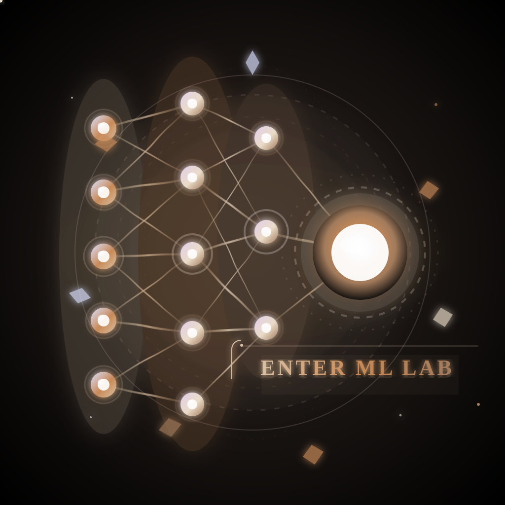

  

  
  
  
  
  

---

  <b>The AI areas I care about most are where mathematical modeling, systems engineering, optimization, and real-world telecommunication meet.</b>

  This page maps the architectural domains behind my projects: low-latency telephony speech streaming, autonomous agent dispatchers, scientific differential equation discovery, and hybrid clinical RAG.

  

## 🔬 Core Domains

  

## 🧪 Labs &amp; Production Architectures

| Lab | Architectural Specialization &amp; Implementation |
| :--- | :--- |
| [**Nexus Platform**](https://nexus.blostem.com) | 1,419-line autonomous dispatch engine spawning Claude Code &amp; Codex CLI streaming child processes with MCP client over SSE. |
| [**VoiceBrew Telephony**](https://voicebrew.ai) | Sub-200ms acoustic telephony speech streaming pipeline (8kHz to 16kHz resampling) over Twilio trunking across 12 channels. |
| [**LinkOps Router**](https://github.com/HIMpcgithub3000/linklops) | Sub-3ms Redis cache engine &amp; PostgreSQL Row-Level Security isolating 100% of tenant records with async 1-hour rollup workers. |
| [**AI PR Assistant**](https://github.com/HIMpcgithub3000/Ai_pr_assistant) | Multi-agent autonomous code inspection using CrewAI &amp; LangGraph with Kafka queue prioritization and isolated Docker runner sandbox. |
| [**Vernacular FD Advisor**](https://github.com/HIMpcgithub3000/Vernacular-FD-Advisor) | 15-Language citation-grounded voice assistant with Web Speech API and Python/FAISS backend. |
| [**NextFlow Builder**](https://github.com/HIMpcgithub3000/nextflow) | Visual DAG workflow builder with topological graph execution chaining Gemini vision transformers. |
| [**MediMind Console**](https://github.com/HIMpcgithub3000/medimind) | Healthcare QA UI with FAISS/ChromaDB hybrid search, local Gemma 3, and SSE streaming chat. |

## 📐 Engineering Principles

  

 

  

