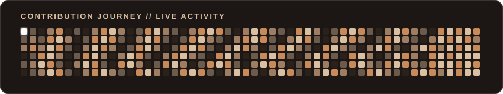

  

  
  
  
  
  

---

  <b>Collaboration is most impactful when anchored around concrete systems: rigorous constraints, hard technical challenges, and clear architectural vision.</b>

  I am especially interested in high-throughput distributed systems, real-time speech telephony, autonomous agent orchestration, and scientific machine learning.

  

---

## 🤝 Collaboration Protocol

I prioritize collaborations where ideas can survive contact with production implementation: concrete problems, a visible technical path, and enough discipline to engineer reliable systems.

| Signal | What it means |
| :--- | :--- |
| `BUILD` | There is a real artifact to design, implement, test, benchmark, or scale. |
| `RESEARCH` | There is a hypothesis worth investigating mathematically or empirically. |
| `SYSTEMS` | The work involves architecture, throughput, reliability, concurrency, or security. |
| `LEARNING` | The output deepens architectural understanding through transparent implementation. |
| `OPEN SOURCE` | The project benefits from public documentation, clean interfaces, and reproducibility. |

## 🎯 High-Value Collaboration Zones

### 1. High-Throughput Backend &amp; Distributed Caching
Distributed caching architectures, single-flight locking mechanisms (avoiding thundering herd problems), PostgreSQL Row-Level Security (RLS) multi-tenant partitions, and async rollup queues.

### 2. Conversational Voice AI &amp; Real-Time Telephony
Low-latency 8kHz to 16kHz audio upsampling, Twilio SIP trunking, Sarvam AI &amp; ElevenLabs TTS, user-turn coalescing, and dual-layer prompt injection defense guardrails.

### 3. Autonomous Multi-Agent Orchestration &amp; Tool Calling
Model Context Protocol (MCP) clients and servers over SSE and HTTP, LangGraph cyclic workflows, CrewAI multi-agent synthesis, and AST zero-trust verification.

### 4. Scientific Machine Learning (SciML)
Sparse identification of nonlinear dynamics (SINDy via STLSQ), mechanistic seasonal SEIRS ODE modeling, and leak-free `TimeSeriesSplit` walk-forward backtesting.

---

## ⚖️ Good Fit / Poor Fit

  

## ⚙️ Operating Style

  

## 📬 Contact Vector

If your project connects to distributed systems, real-time voice telephony, agent orchestration, or applied ML, let's connect:

  
  &nbsp;
  
  &nbsp;
  

---

# 🐍 Contribution Journey

  

 

  

