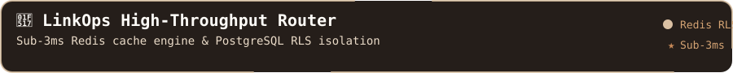
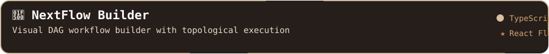
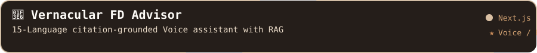

  

  
  
  
  
  

---

  <b>Selected work across high-throughput distributed systems, real-time speech telephony, autonomous agent runtimes, and scientific machine learning.</b>

  This page highlights production systems, flagship engineering architectures, and research labs: building high-performance URL redirection routers, sub-200ms speech AI telephony pipelines, and citation-grounded RAG platforms.

<h2 align="center">🧪 Project Highlights</h2>

<!-- Row 1 -->

  
  

<!-- Row 2 -->

  
  

## 📋 Comprehensive Project Index

| Project | Domain & Focus | Tech Stack | Status | Key Engineering Metric / Why it Matters |
| :--- | :--- | :--- | :--- | :--- |
| [**LinkOps**](https://github.com/HIMpcgithub3000/linklops) | High-throughput multi-tenant URL redirector & analytics | Python, PostgreSQL RLS, Redis, `pg_trgm` | Production-Ready | Sub-3ms redirect latency via single-flight distributed locks; 100% tenant partition under RLS. |
| [**Nexus**](https://nexus.blostem.com) | Autonomous agent dispatcher & incident triage runtime | TypeScript, MCP over SSE, Claude Code, SigNoz | Live Platform | 1,419-line runtime; slashed triage from 3 hrs to 10 mins; 700+ regression tests. |
| [**VoiceBrew**](https://voicebrew.ai) | Acoustic speech streaming telephony engine | Python, Twilio Trunking, Sarvam AI, ElevenLabs, Gemini 2.5 Flash | Live Platform | Sub-200ms audio stream (8k to 16kHz); 100% prompt injection defense across 5k+ tests. |
| [**AI PR Assistant**](https://github.com/HIMpcgithub3000/Ai_pr_assistant) | Multi-agent autonomous code inspection platform | Python, CrewAI, LangGraph, Kafka, Docker | Active | Kafka prioritized queue (`P0-P3`); Dockerized sandbox runner; zero hallucinated comments via AST gate. |
| [**NextFlow**](https://github.com/HIMpcgithub3000/nextflow) | Visual DAG builder & multimodal workflow engine | TypeScript, React Flow, Node.js topological runner | Active | Deterministic topological graph executor chaining Gemini vision & media workers. |
| [**SciML Epidemiological Forecasting**](https://github.com/HIMpcgithub3000/influenza-forecasting-hhs-regions) | Scientific ML: SINDy sparse discovery + Seasonal SEIRS ODE | Python, SciPy, SINDy, STLSQ, joblib | Completed | 47.6% lower RMSE vs. Prophet; symbolic ODE discovery with $L_0$ sparsity. |
| [**Quantitative Stock Forecasting**](https://github.com/HIMpcgithub3000/Quantitative_analysis_of_stocks) | Econometric modeling & GBDT walk-forward backtesting | Python, scikit-learn, ARIMA, TimeSeriesSplit | Completed | 2.12% out-of-sample MAPE across 11,325 OHLCV bars without lookahead bias. |
| [**TigerSentinel**](https://github.com/HIMpcgithub3000/TigerSentinel-Agentic-Fraud-Investigation) | Graph-first agentic fraud investigation | Python, TigerGraph Savanna Cloud, Agents | Active | Multi-hop subgraph query engine resolving synthetic identities and circular flows. |
| [**Razorpay RecoverAI**](https://github.com/HIMpcgithub3000/razorpay-recoverai) | Autonomous autopay failure recovery voice engine | TypeScript, Voice Telephony, Webhooks | Active | Real-time conversational recovery of failed subscription mandates with intelligent retries. |
| [**Vernacular FD Advisor**](https://github.com/HIMpcgithub3000/Vernacular-FD-Advisor) | Multilingual voice wealth advisor (15 Indian languages) | TypeScript, Web Speech API, FAISS, Python | Awardee | Citation-grounded RAG with deterministic tabular calculation tools across 100+ schemes. |
| [**MediMind**](https://github.com/HIMpcgithub3000/medimind) | Healthcare information retrieval & hybrid RAG | TypeScript, FAISS, ChromaDB, local Gemma 3 | Active | SSE streaming QA UI with cross-encoder reranking and citation-grounded outputs. |
| [**Glaucoma Detection**](https://github.com/HIMpcgithub3000/Glaucoma_Dectection_Machine_learning) | Explainable multimodal ophthalmic vision | PyTorch, CNNs, Grad-CAM, SHAP | Completed | 80% accuracy, 0.80 AUC across 2,800+ multimodal images with saliency maps. |
| [**NHCX Claim Extraction**](https://github.com/HIMpcgithub3000/NHCx) | Unstructured hospital claim PDF to HL7 FHIR R4 JSON | Python, PyMuPDF, Pydantic, local Gemma 3 | Finalist | Zero extraction errors across 150+ claims; National Hackathon Finalist. |

## Current Direction

  

## What To Look At First

  

---

<h2 align="center">📊 Activity &amp; Vital Statistics</h2>

  

  

 

  

